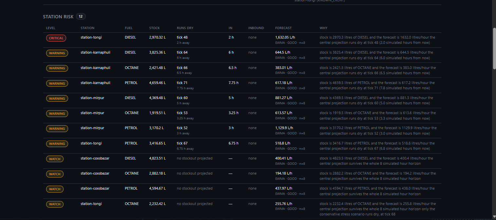
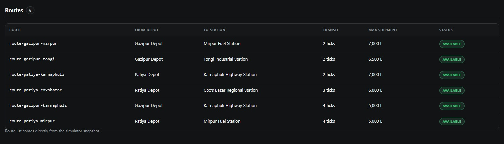
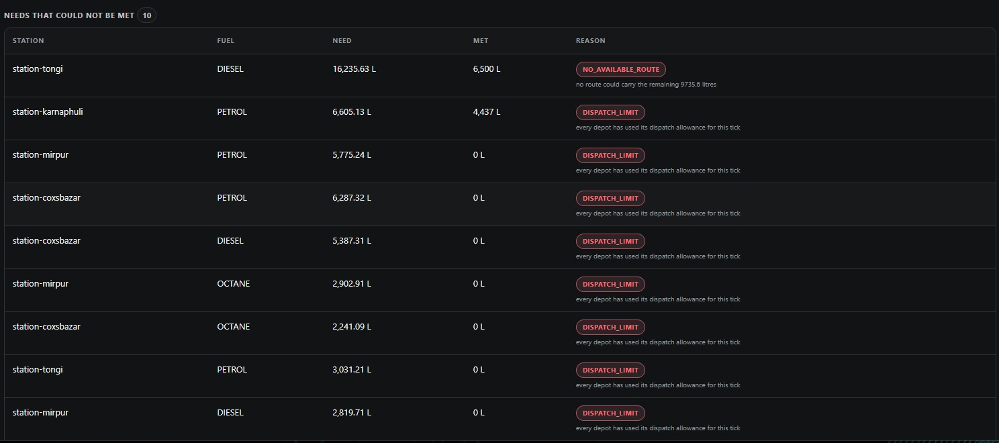
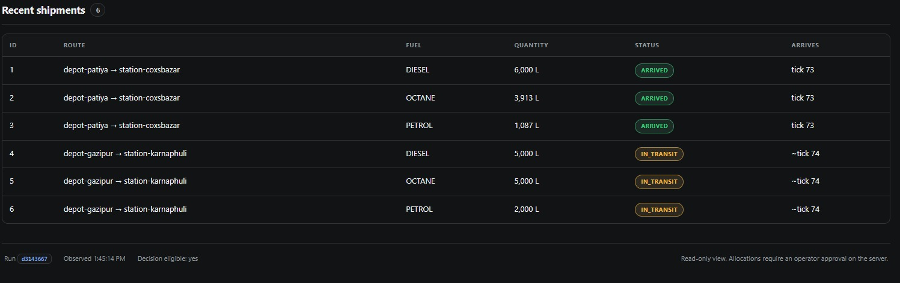
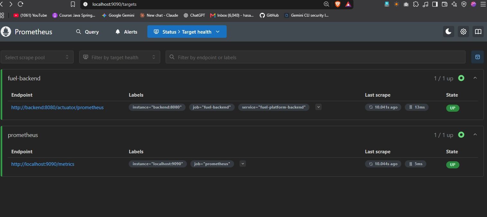
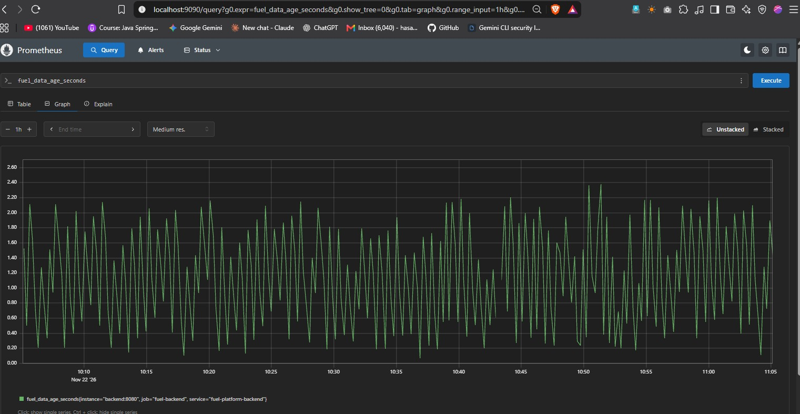
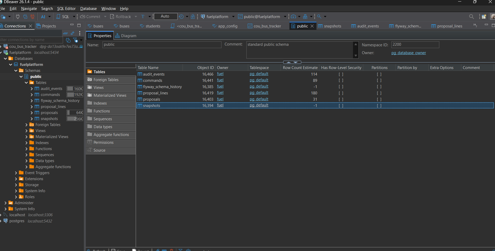
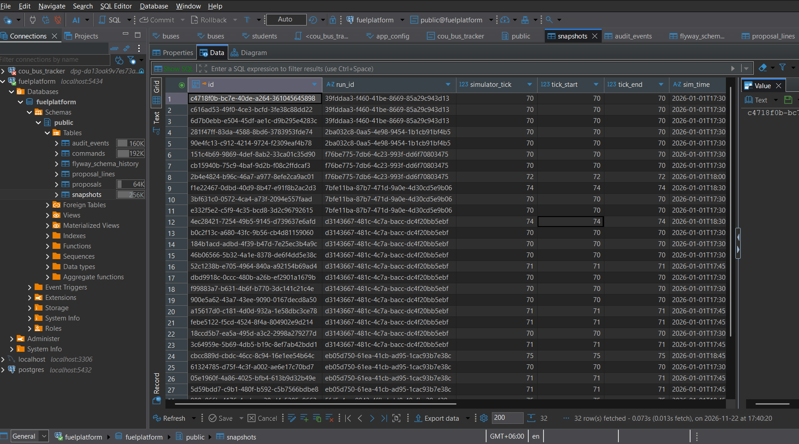

<div align="center">

# ⛽ Fuel Supply Intelligence

### Explainable risk analysis, operator-approved decisions, and resilient supply coordination for a simulated fuel network

An operator platform built around the **official BUP Fuel Supply Simulator**.

<p>
  
  
  
  
  
</p>

<p>
  <a href="#project-status">Project status</a> ·
  <a href="#verification-snapshot">Verification</a> ·
  <a href="#capabilities">Capabilities</a> ·
  <a href="#architecture">Architecture</a> ·
  <a href="#phased-execution-plan">Execution plan</a> ·
  <a href="#run-locally">Run locally</a>
</p>

</div>

---

## Project status

| Latest milestone | Status date | Release target |
|---|---|---|
| **Phase 04 · Evaluation & Release Rehearsal** | **Complete · 25 Nov 2026** | **24 Nov 2026** |
| **VPS reviewer demo** | **Preparation complete; server rollout in progress · 26 Nov 2026** | **After VPS verification** |

**VPS rollout status:** the repository has a dedicated [Ubuntu VPS deployment
guide](docs/vps-deployment.md), and `fuel-demo.kubijatra.com` resolves to the
VPS. A separate project directory and conflict-free local port plan are
prepared. The latest code still needs to be pulled on the VPS, images built,
containers started, and the isolated Nginx/HTTPS/Basic Auth route verified
before the demo URL is considered live.

The application turns simulator snapshots into station and depot risk, anomaly flags, forecasts, and constraint-checked shipment proposals. Operators review proposals and approve them through a persisted, idempotent command flow; reconciliation tracks the simulator's shipment state. Phase 03 adds a circuit breaker, bounded retries, an SSE refresh path with a REST polling fallback, refusal and recovery metrics, a resilience dashboard, and Prometheus alert rules as code.

**The result in one line:** the platform survives a simulator outage without lying about it — during a total outage the simulator's own `/v1/health` still answered `HTTP 200 ok`, and the console showed `INVALID`, refused the approval with `STALE_OR_INVALID_SNAPSHOT`, opened the circuit breaker, and recovered on its own — with **4** live fault timelines, **154** backend tests, **31** frontend tests, **8** alert rules loaded, and the previous day's end-to-end verifier still at **17/17**.

### Day 4 completion and audit summary

Day 4's resilience and observability work is complete for the local project scope. The table below links the measured results to their audit artifacts. The independent reviewer handoff is prepared; an external review has not been performed.

| Audit area | Recorded result | Evidence |
|---|---|---|
| Backend regression suite | **154 passed**, 0 failures, 0 errors, 0 skipped; clean build succeeded | [Latest backend test run](docs/evidence/day-04/backend-tests-latest.txt) |
| Frontend checks | **31 tests passed** in the recorded suite; the latest TypeScript/Vite production image build also succeeded after adding `Generate proposal` to Decisions. The suite was not rerun for that UI change. | [Frontend test/build capture](docs/evidence/day-04/frontend-tests.txt), [proposal button build](docs/evidence/day-04/frontend-proposal-build.txt) |
| Simulator failure handling | Unavailable, stale-response, and latency scenarios recorded; stale/ineligible approval attempts were refused. The breaker opened on availability failures and recovered. | [Unavailable](docs/evidence/day-04/fault-unavailable.txt), [stale](docs/evidence/day-04/fault-stale.txt), [latency](docs/evidence/day-04/fault-latency.txt), [breaker trace](docs/evidence/day-04/breaker-trace.txt) |
| Event stream and refresh load | Disconnect/reconnect retained REST polling fallback. In a **16.14 s** RUNNING sample, **76** stream events coalesced to **50** refresh triggers and simulator calls were reduced by **333**. | [Stream fallback](docs/evidence/day-04/stream-fallback.txt), [refresh volume](docs/evidence/day-04/running-refresh-volume.txt) |
| Combined demand and route crisis | Six event-attributed anomaly flags; Mirpur supply used the Patiya route; Tongi had **54.1 L** unmet. Both injected events resolved by tick 44. | [Combined crisis](docs/evidence/day-04/event-combined-crisis.txt) |
| Monitoring baseline | **8/8** Prometheus rules healthy after clean startup; no active alerts in that capture. | [Post-startup metrics](docs/evidence/day-04/metrics-after-clean-start.txt) |
| Day 3 regression | **17/17** checks passed against Day 4 changes. | [Regression run](docs/evidence/day-04/day3-regression.txt) |
| Review handoff | Run ID, snapshot, service status, logs, and resilience metrics assembled; independent review remains pending. | [Incident handoff](docs/evidence/day-04/incident-handoff.txt) |

After a clean startup the simulator is paused at tick 0, where there may be no shipment recommendations. Advance to a scenario with projected shortages before generating a proposal. Proposal creation itself does not dispatch fuel; an operator must review and approve it.

## Overview

The platform is an operator console over a simulated fuel network. The simulator owns the live network state; this application reads and validates that state, adds monitoring and decision-support views, and sends shipment requests only after server-enforced operator approval.

| Capability | Current state |
|---|---|
| Simulator integration and validated network snapshots | Implemented |
| Station/depot inventory, health, freshness, and filters | Implemented |
| Demand forecasts, stockout risk, and rule-based anomaly flags | Implemented |
| Constraint-checked shipment proposals with alternatives and unmet-need reasons | Implemented; proposals are advisory |
| Prometheus metrics and provisioned Grafana overview | Implemented |
| Operator proposal review, approval, idempotent shipment commands, reconciliation, and audit records | Implemented |
| Durable decision record in PostgreSQL (snapshots, proposals, lines, commands, audit events) | Implemented; five tables with database-enforced constraints |
| Circuit breaker with separate read and write channels, bounded read retries | Implemented; the breaker counts availability failures, not domain errors |
| SSE event refresh with a coalesced re-read and a REST polling fallback | Implemented; the stream is a hint, never the source of truth |
| Approval-refusal and recovery metrics, a resilience dashboard, and alert rules as code | Implemented; 8 Prometheus rules, each with a runbook reference |

**Source of truth:** station inventory, depot inventory, demand, and shipment state come from the simulator. PostgreSQL stores application observations and decision/command/audit records; it does not replace the simulator as the authority for operational fuel state.

## Technology stack

| Layer | Technologies | Purpose in this platform |
|---|---|---|
| Frontend | React 18.3, TypeScript 5.6, Vite 6, custom CSS | Operator dashboard, filters, risk views, proposal review, and shipment ledger |
| Visualization | React components and CSS | Inventory cards, route/risk/decision tables, status badges, and stock-level meters |
| Backend API | Java 25, Spring Boot 3.5.7, Spring Web, Validation | Dashboard, risk, status, proposal, approval, and shipment REST APIs |
| Integration and workers | Spring scheduling, typed simulator REST client | Snapshot refresh, validation, command sending, and shipment reconciliation |
| Database | PostgreSQL 16 Alpine, JDBC, Flyway | Persisted snapshots, proposals, commands, and audit events |
| Intelligence | Java EWMA/naive/profile forecasts, rule-based anomaly detection, constrained allocation | Demand estimates, stockout risk, explainable anomaly flags, and feasible proposals |
| Observability | Prometheus 3.5, Grafana 12.0.2, Spring Actuator, Micrometer | Backend metrics scraping and provisioned operations overview |
| Testing | Spring Boot Test, JUnit, Mockito, Vitest 5.1 | Backend decision/integration coverage and frontend behavior checks |
| Containerization | Docker, Docker Compose (6 services) | Local stack for the app, database, official simulator, and monitoring |

Version values reflect the repository's dependency manifests and Compose configuration.

## Verification snapshot

Every number below was measured against the running stack. Nothing here is a transcription.

| Check | Recorded result | Evidence |
|---|---|---|
| Day 4 failure boundary under a simulator outage | `FRESH` → `INVALID` → `FRESH`, breaker `CLOSED` → `OPEN` → `CLOSED`, approval refused | [fault-unavailable.txt](docs/evidence/day-04/fault-unavailable.txt) |
| Day 4 stale guard | HTTP 200 + stale header → `STALE`, ineligible, approval refused | [fault-stale.txt](docs/evidence/day-04/fault-stale.txt) |
| Day 4 slow simulator is not a dead one | Under `latency` the view is `INVALID` and the approval refused, but the breaker stays `CLOSED` | [fault-latency.txt](docs/evidence/day-04/fault-latency.txt) |
| Day 4 circuit breaker, second by second | `OPEN` from t+4s to t+16s, `opened_total=1`, `rejections=14` | [breaker-trace.txt](docs/evidence/day-04/breaker-trace.txt) |
| Day 4 combined crisis | 6 event-attributed flags; Mirpur rerouted; 54.1 L unmet at Tongi; both events resolved by tick 44 | [event-combined-crisis.txt](docs/evidence/day-04/event-combined-crisis.txt) |
| Prometheus alert rules | **8 loaded**, health `ok` | [metrics-steady-state.txt](docs/evidence/day-04/metrics-steady-state.txt) |
| Day 4 UI in the served bundle | 7/7 strings, `.banner-danger` present, 5/5 safety checks | [frontend-ui-checks.txt](docs/evidence/day-04/frontend-ui-checks.txt) |
| Day 3 regression against the Day 4 code | **17/17 checks passed** | [day3-regression.txt](docs/evidence/day-04/day3-regression.txt) |
| Backend clean build and tests | **157 passed**, 0 failures, 0 errors, 0 skipped · `BUILD SUCCESS` | [backend-tests.txt](docs/evidence/day-04/backend-tests.txt) |
| Frontend tests | `npm run test` — **31 passed** (22 filters, 9 decision types) | [frontend-tests.txt](docs/evidence/day-04/frontend-tests.txt) |
| Frontend production build | `npm run build` — **passed**, clean type check and bundle | [frontend-tests.txt](docs/evidence/day-04/frontend-tests.txt) |
| Day 3 live decision flow | **20/20 acceptance checks passed** | [end-to-end-verification.txt](docs/evidence/day-03/end-to-end-verification.txt) |
| Day 3 UI strings in the served bundle | **12/12 present** | [frontend-checks.txt](docs/evidence/day-03/frontend-checks.txt) |
| Schema as the database holds it | 5 tables, `uq_command_line`, `uq_command_key`, `chk_final_not_above_reviewed` | [schema-and-ledger.txt](docs/evidence/day-03/schema-and-ledger.txt) |
| Day 1 simulator contract | **34/34 end-to-end checks passed** | [Day 1 evidence](docs/evidence/day-01/) |
| Demand-profile measurement | **97/98** documented hourly factors matched in the measured run | [Day 2 measurements](docs/daily/Day-02.md) |
| Anomaly detector check | **0 false flags** in a quiet run; injected R1/R2 anomalies detected within **2 ticks** | [Day 2 measurements](docs/daily/Day-02.md) |
| Shared dispatch limit | Held across every fuel and destination at a depot | [Day 2 measurements](docs/daily/Day-02.md) |

## Architecture


The browser talks only to the Spring Boot API. The backend communicates with the simulator over its REST API. Prometheus scrapes backend metrics, and Grafana reads those metrics from Prometheus. All services run locally through Docker Compose.

```
browser ──▶ Spring Boot API ──▶ official simulator  (REST)
                │
                ├──▶ PostgreSQL   snapshots · proposals · commands · audit
                │
                └──▶ /actuator/prometheus ──▶ Prometheus ──▶ Grafana
```

## Screenshots

| Operator console | Risk and forecasting |
|---|---|
| **Station inventory and service health**<br> | **Risk summary and anomaly flags**<br> |
| **Depot inventory and shipment view**<br> | **Station stockout risk**<br> |
| **Network inventory and active-event view**<br> | **Depot risk and recommendations**<br> |
| **Proposal alternatives and unmet needs**<br> | **Grafana service health**<br> |
| **Grafana metrics overview**<br> | **Grafana sign-in screen**<br> |

The event screenshot shows one simulator scenario; values and event state can change as the simulator runs. Grafana credentials are configurable in `.env` (see `.env.example`).

### Proposal, route, shipment, and Prometheus views

| Operator decisions | Network and risk |
|---|---|
| **Proposal review history**<br> | **Proposal review and approval bounds**<br> |
| **Simulator route inventory**<br> | **Unmet supply needs**<br> |
| **Active demand-spike event**<br> | **Shipment ledger and route status**<br> |
| **Prometheus scrape targets**<br> | **Prometheus data-age metric**<br> |
| **Prometheus runtime information**<br> | **Grafana resilience dashboard — healthy baseline**<br> |

### PostgreSQL persistence

The screenshots show the Day 3 application tables in the local `fuelplatform` database. The database stores validated snapshots and decision/audit records; the simulator remains the source of truth for live fuel and shipment state. The local desktop-client connection uses `localhost:5434` (the Compose container listens on `5432` internally).

| Database structure | Persisted application records |
|---|---|
| **Schema and tables**<br> | **Validated snapshots**<br> |
| **Proposal lines**<br> | **Audit events**<br> |

## The decision path

This is the flow the whole platform exists to make safe. Each step names the rule it enforces.

```
simulator snapshot
      │
      ▼
┌─────────────────────────────────────────────────────────────────┐
│ 1. VALIDATE      the payload, the freshness, and the stale header│
│ 2. FORECAST      demand per (station, fuel), oldest tick first │
│ 3. PROJECT       hours to stockout, and the signals behind them │
│ 4. ALLOCATE      feasible lines, a shared dispatch budget,      │
│                  alternatives with reasons, unmet needs          │
└─────────────────────────────────────────────────────────────────┘
      │
      ▼
  PROPOSAL  ── no simulator write happens here, ever
      │
      ▼  operator reviews, and may lower any quantity
┌─────────────────────────────────────────────────────────────────┐
│ 5. REVALIDATE    against a FRESH world, per line                │
│                  · quantity may fall, never rise                │
│                  · a changed line sends nothing and says why    │
│                  · the depot's shared budget is re-reserved     │
│ 6. PERSIST       the idempotency key and the EXACT body,       │
│                  BEFORE any POST                                │
│ 7. SEND          one POST, one key, one body                   │
│                  · a timeout is UNKNOWN, never REJECTED         │
│ 8. RECONCILE     match the key against GET /v1/allocations     │
│                  · never send again                             │
│ 9. AUDIT         every decision, including the refused ones    │
└─────────────────────────────────────────────────────────────────┘
```

### Rules the database enforces

These are structural, not procedural. A second command for one proposal line **cannot be stored**, and a final quantity above the reviewed quantity **cannot be stored**.

| Constraint | What it makes impossible |
|---|---|
| `uq_command_line (proposal_line_id)` | One proposal line producing two commands |
| `uq_command_key (idempotency_key)` | One idempotency key producing two shipments |
| `chk_final_not_above_reviewed` | A shipped quantity above what the operator reviewed |
| `chk_command_status` | A command status outside the known vocabulary |
| `chk_line_status` | A line status outside the known vocabulary |

### The two clocks

| Clock | Controls | Examples |
|---|---|---|
| **Simulation tick** | The fuel world | Tick conversion, route transit, supply arrivals, stockout horizons |
| **Wall clock** | The software | Request timeouts, cache age, circuit breakers, fault expiry, proposal expiry |

A paused simulator can sit on one tick for ten minutes while its API is perfectly reachable. **That is not stale.** Staleness is measured against the last successful *validated* REST refresh, tracked separately from the tick.

At the configured `SIMULATION_SPEED=8`, `TICK_MINUTES=15`, this machine sustains **5.46 ticks/sec** — roughly **82 simulated minutes per wall second**. A 30-second review spans about **41 simulated hours**. That is why the tick-lag rule cannot be the only control, and why a proposal is an envelope rather than a frozen order.

## Phased execution plan

Each phase links to its detailed Markdown update. The dates below reflect the actual start and completion schedule; implementation notes and evidence remain in the linked documents.

| Phase | Milestone | Focus areas | Target date / status |
|---|---|---|---|
| [Phase 00 · Day 1](docs/daily/Day-01.md) | Bootstrap & simulator contract | Simulator experiments, typed integration, validated dashboard, Compose, CI, metrics | Fri 20 Nov · **Done** |
| [Phase 01 · Day 2](docs/daily/Day-02.md) | Intelligence & risk | Forecasts, station/depot projections, anomaly detection, constrained proposals | Sat 21 Nov · **Done** |
| [Phase 02 · Day 3](docs/daily/Day-03.md) | Persistence & operator decisions | Durable records, human approval, idempotent command processing, shipment tracking | Sun 22 Nov · **Done** |
| [Phase 03 · Day 4](docs/daily/Day-04.md) | Resilience & observability | Fault recovery, guarded writes, SSE, crisis scenarios, operations evidence | Mon 23 Nov · **Done** |
| [Phase 04 · Day 5](docs/daily/Day-05.md) | Evaluation & release rehearsal | Policy comparison, load evaluation, clean startup, documentation, demo rehearsal | **Complete · 25 Nov 2026** |

## Project structure

```text
Fuel-Management-System/
├── backend/
│   ├── src/main/java/com/fuelplatform/
│   │   ├── allocation/       # Constraint-aware shipment proposal planning
│   │   ├── audit/            # Durable decision and command audit events
│   │   ├── command/          # Idempotent shipment commands and reconciliation
│   │   ├── config/           # Simulator, forecast, risk, clock, and health settings
│   │   ├── decision/         # Proposal review, approval, and persistence
│   │   ├── domain/           # Snapshot and simulation domain types
│   │   ├── ingestion/        # Snapshot refresh, validation, and publication
│   │   ├── observability/    # Health state and operational metrics
│   │   ├── risk/             # Demand forecast, anomaly, and supply-risk logic
│   │   ├── simulator/        # Simulator HTTP client, DTOs, and metrics
│   │   └── web/              # Dashboard, risk, decision, and system-status REST endpoints
│   └── src/main/resources/db/migration/   # Flyway migrations
│   └── src/test/             # Backend unit and integration tests
├── frontend/
│   └── src/
│       ├── App.tsx           # Operator console composition
│       ├── DecisionPanel.tsx # Proposal approval and shipment ledger
│       ├── RiskPanel.tsx     # Risk and proposal views
│       ├── decisionTypes.ts  # Decision API types and status vocabulary
│       ├── filters.ts        # Fuel and region filtering
│       ├── useDashboard.ts   # Dashboard API/state hook
│       ├── useDecisions.ts   # Proposal, approval, and ledger API/state hook
│       └── useRisk.ts        # Risk API/state hook
├── infra/
│   ├── grafana/provisioning/ # Prometheus data source and dashboard setup
│   └── prometheus/           # Prometheus scrape configuration
├── images/                   # Architecture and README screenshots
├── scripts/                  # Local simulator and behavior verification helpers
├── docs/
│   ├── adr/                  # Architecture decision records
│   ├── daily/                # Day-by-day implementation notes and evidence
│   ├── evidence/             # Captured measurements and verification evidence
│   ├── issues/               # Feature and implementation specifications
│   ├── acceptance-and-invariants.md
│   ├── agent-activity-log.md
│   ├── contract-notes.md
│   ├── current-state.md
│   └── system-architecture.md
├── compose.yaml              # Local multi-service deployment
└── .env.example              # Example local configuration
```

## Run locally

Requirements: Docker Desktop with Compose enabled. From the repository root:

```powershell
Copy-Item .env.example .env   # only needed if you do not already have a local .env
docker compose up --build -d
docker compose ps
```

Open the services:

| Service | Local URL |
|---|---|
| Fuel Supply Intelligence UI | [http://localhost:5173](http://localhost:5173) |
| Backend API | [http://localhost:8080](http://localhost:8080) |
| Simulator API | [http://localhost:8000](http://localhost:8000) |
| Prometheus | [http://localhost:9090](http://localhost:9090) |
| Grafana | [http://localhost:3000](http://localhost:3000) |

Stop the services with `docker compose down`. Add `-v` only when you intend to remove named volumes as well.

> **After any frontend change**, run `docker compose build frontend` before `docker compose up -d frontend`. The container serves a built bundle, so without the rebuild it keeps serving the previous one.

## Deploy a reviewer demo on the VPS

The reviewer demo is planned on the existing Ubuntu 24.04 VPS, alongside its
current sites and services. The measured host has 2 vCPU, 3.8 GiB RAM, 48 GiB
disk (about 35 GiB free at inspection), and no swap. Nginx already owns public
ports 80/443; an existing Java service uses host port 8080, and another
project's PostgreSQL uses `127.0.0.1:5432`.

The Fuel stack stays in `/opt/fuel-management-system`. Its six service ports
are mapped to loopback only: frontend `15173`, backend `18080`, simulator
`18000`, PostgreSQL `15432`, Prometheus `19090`, and Grafana `13000`. Nginx
will route only `fuel-demo.kubijatra.com` to the frontend; it will not replace
the existing `kubijatra.com` virtual hosts. Cloudflare DNS for the new
subdomain is configured and resolves to the VPS. The remaining rollout steps
are pull the pushed revision, build images sequentially, start/check the
containers, add a separate password-protected Nginx site, issue TLS, and verify
the URL. See the [step-by-step VPS configuration and operations guide](docs/vps-deployment.md).

**Current deployment state:** DNS and repository checkout are prepared, but
the VPS update/build/start and HTTPS access check are not yet confirmed. Do not
share the hostname as a live demo until those checks pass. The application has
no built-in user authentication; Nginx Basic Auth is a temporary shared gate
for trusted reviewers, not per-user identity or role-based authorization.

## How the data flows

1. The official simulator maintains the simulated fuel network and its state.
2. The backend periodically reads simulator data, validates and persists snapshots, and exposes the operator API. Main routes: `/api/dashboard`, `/api/risk`, `/api/system-status`, `/api/proposals`, `/api/shipments`.
3. The React frontend reads the backend API and renders inventory, freshness, risk, anomalies, and advisory proposals. It does not call the simulator directly.
4. Prometheus collects backend metrics from `/actuator/prometheus`; Grafana queries Prometheus for its provisioned overview.

Shipment proposals are decision support until an operator approves them. The backend revalidates each approval, persists command intent and its idempotency key before sending the request, then reconciles the result against simulator state. PostgreSQL stores snapshots, proposals, commands, and audit events; the simulator remains authoritative for fuel and shipment state.

## Simulator contract facts

These were **measured**, not read from documentation. They are the ones that change how the code must be written.

1. Depot inventory is already net of pending and in-transit shipments; do not subtract them again.
2. Dispatch allowance is shared per depot across fuels and destinations, and it is consumed at POST time.
3. `X-Simulator-Stale: true` can accompany HTTP 200; inspect the header and freshness data.
4. Demand history is newest-first; sort oldest-first before forecasting.
5. Forecast `demand_liters`, not `served_liters`.
6. A shared history limit applies across fuels; split the returned rows by fuel after fetching.
7. `/v1/health` bypasses fault injection; reachability is not data freshness.
8. Simulator errors have multiple response shapes; normalize them in the adapter.
9. Configured simulator speed is not a guaranteed tick rate.
10. Simulation ticks measure fuel-world time; wall-clock age measures application data freshness.
11. A transport error message contains a double-quoted URL. Any JSON built by string concatenation from a simulator message will be invalid — serialise a map instead.

The full measurements are in [contract notes](docs/contract-notes.md).

## Build and verification

Run these from the repository root when working on the corresponding component:

```powershell
Set-Location backend
.\mvnw.cmd clean verify
```

```powershell
Set-Location frontend
npm ci
npm run test
npm run build
```

The scripts in `scripts/` exercise simulator behaviour and allocation invariants. Some of them **mutate** the live simulator and database, so run them against a disposable local stack rather than a demo state you want to keep.

```powershell
python scripts/verify_day1.py                   # 34 simulator-contract checks
python scripts/verify_day3_end_to_end.py        # 20 Day 3 decision-path checks (mutates the stack)
python scripts/verify_frontend_day3_ui.py       # 12 Day 3 UI strings in the served bundle
python scripts/verify_frontend_day3_css.py      # the table rules and the card grid
python scripts/inspect_day3_schema.py           # the schema as the database holds it

python scripts/inject_fault.py unavailable 30   # Day 4: the full failure boundary (mutates the stack)
python scripts/inject_fault.py stale 30          # Day 4: the stale guard
python scripts/inject_fault.py event demand_spike 8   # Day 4: a crisis event
python scripts/trace_breaker_during_fault.py    # Day 4: the breaker, second by second
python scripts/verify_frontend_day4_ui.py       # Day 4: the resilience UI in the served bundle
```

CI configuration is in `.github/workflows/`.

## Documentation

- [System architecture](docs/system-architecture.md) — component diagram, communication paths, and ownership boundaries
- [Architecture notes](docs/architecture-diagram.md) — design context and simulator behaviour
- [Acceptance criteria and invariants](docs/acceptance-and-invariants.md) — the operational rules, INV-1 to INV-46
- [Contract notes](docs/contract-notes.md) — integration details and API observations
- [Current state](docs/current-state.md) — implementation status and verification notes
- [Day 4 — Resilience & observability](docs/daily/Day-04.md) — the failure boundary, the breaker, the stream, and the evidence
- [Day 4 evidence](docs/evidence/day-04/README.md) — the recorded fault timelines and how to reproduce them
- [Agent activity log](docs/agent-activity-log.md) — what was built, what broke, and why
- [Architecture decisions](docs/adr/) — recorded design decisions
- [Issue board](docs/issue-board.md) — tracked work and specifications

## Simulator attribution

This project integrates with the official BUP Fuel Supply Simulator image configured in `compose.yaml`. Its simulated network remains the authority for fuel inventory, demand, and shipment state.
