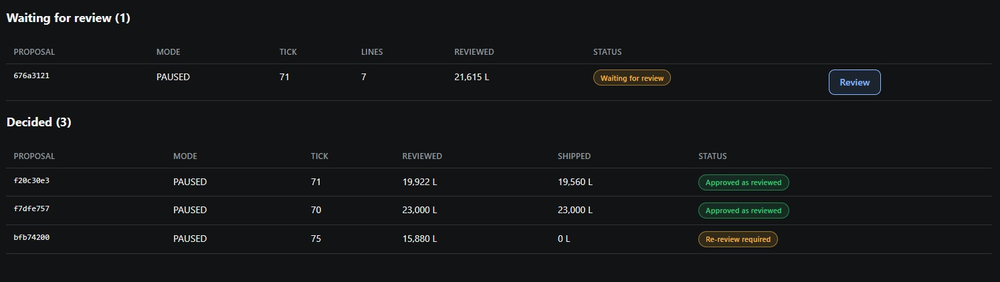
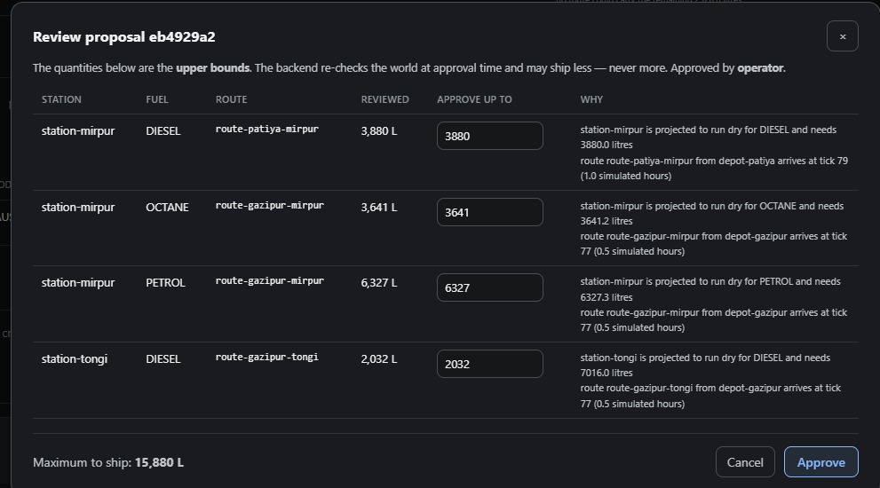
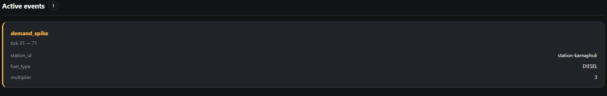
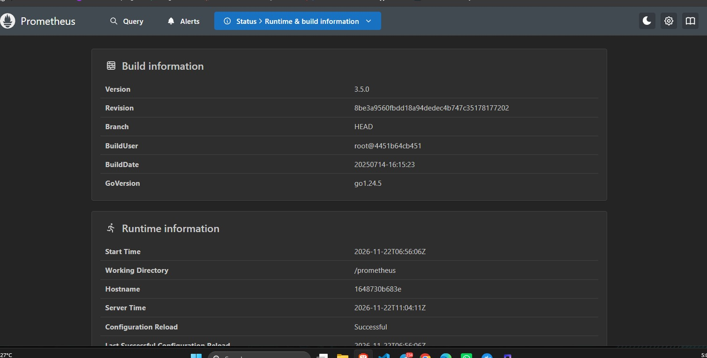
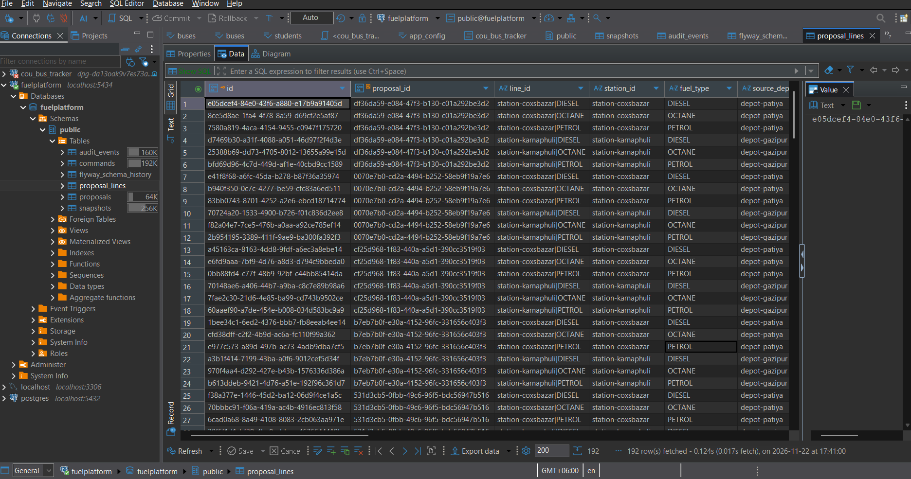
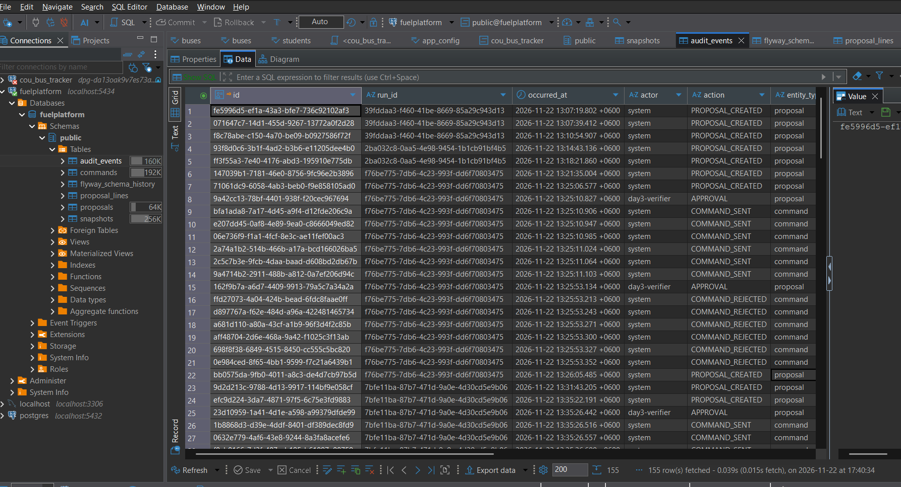

<div align="center">

# ⛽ Fuel Supply Intelligence

### Explainable risk analysis and supply recommendations for a simulated fuel network

An operator platform built around the **official BUP Fuel Supply Simulator**.

<p>
  
  
  
  
  
</p>

<p>
  <a href="#project-status">Project status</a> ·
  <a href="#phased-execution-plan">Execution plan</a> ·
  <a href="#architecture">Architecture</a> ·
  <a href="#run-locally">Run locally</a>
</p>

</div>

---

## Project status

| Latest milestone | Status date | Release target |
|---|---|---|
| **Phase 02 · Persistence & Operator Decisions** | **Complete · 22 Nov 2026** | **24 Nov 2026** |

The application turns simulator snapshots into station and depot risk, anomaly flags, forecasts, and constraint-checked shipment proposals. Operators can review proposals and approve them through a persisted, idempotent command flow; reconciliation tracks the simulator's shipment state.

## Overview

The platform is an operator console over a simulated fuel network. The simulator owns the live network state; this application reads and validates that state, adds monitoring and decision-support views, and sends shipment requests only after server-enforced operator approval.

| Capability | Current state |
|---|---|
| Simulator integration and validated network snapshots | Implemented |
| Station/depot inventory, health, freshness, and filters | Implemented |
| Demand forecasts, stockout risk, and rule-based anomaly flags | Implemented |
| Constraint-checked shipment proposals with alternatives and unmet-need reasons | Implemented; proposals are advisory |
| Prometheus metrics and provisioned Grafana overview | Implemented |
| Operator proposal review, approval, idempotent shipment commands, reconciliation, and audit records | Implemented |

**Source of truth:** station inventory, depot inventory, demand, and shipment state come from the simulator. PostgreSQL stores application observations and decision/command/audit records; it does not replace the simulator as the authority for operational fuel state.

## Technology stack

| Layer | Technologies | Purpose in this platform |
|---|---|---|
| Frontend | React 18.3, TypeScript 5.6, Vite 6, custom CSS | Operator dashboard, filters, risk views, proposal review, and shipment ledger |
| Visualization | React components and CSS | Inventory cards, route/risk/decision tables, status badges, and stock-level meters |
| Backend API | Java 25, Spring Boot 3.5.7, Spring Web, Validation | Dashboard, risk, status, proposal, approval, and shipment REST APIs |
| Integration and workers | Spring scheduling, typed simulator REST client | Snapshot refresh, validation, command sending, and shipment reconciliation |
| Database | PostgreSQL 16 Alpine, JDBC, Flyway | Persisted snapshots, proposals, commands, and audit events |
| Intelligence | Java EWMA/naive/profile forecasts, rule-based anomaly detection, constrained allocation | Demand estimates, stockout risk, explainable anomaly flags, and feasible proposals |
| Observability | Prometheus 3.5, Grafana 12.0.2, Spring Actuator, Micrometer | Backend metrics scraping and provisioned operations overview |
| Testing | Spring Boot Test, JUnit, Mockito, Vitest 5.1 | Backend decision/integration coverage and frontend behavior checks |
| Containerization | Docker, Docker Compose (6 services) | Local stack for the app, database, official simulator, and monitoring |

Version values reflect the repository's dependency manifests and Compose configuration.

## Verification snapshot

| Check | Recorded result |
|---|---|
| Backend clean compile and tests | `mvn clean verify` — **126 passed**, 0 failures |
| Frontend tests | `npm run test` — **31 passed** |
| Frontend production build | `npm run build` — **passed** |
| Day 3 live decision flow | **17/17 acceptance checks passed**; proposal creation, duplicate approval, quantity bounds, unknown-outcome reconciliation, shipment tracking, and audit trail |
| Demand-profile measurement | **97/98** documented hourly factors matched in the measured run |
| Anomaly detector check | **0 false flags** in a quiet run; injected R1/R2 anomalies detected within **2 ticks** |

Risk thresholds remain proposed and are not claimed as tuned. A dedicated k6/load benchmark has not been recorded yet. See [Day 3 evidence](docs/evidence/day-03/README.md) and [Day 2 measurements](docs/daily/Day-02.md) for details.

## Architecture


The browser talks only to the Spring Boot API. The backend communicates with the simulator over its REST API. Prometheus scrapes backend metrics, and Grafana reads those metrics from Prometheus. All services run locally through Docker Compose.

## Screenshots

| Operator console | Risk and forecasting |
|---|---|
| **Station inventory and service health**<br> | **Risk summary and anomaly flags**<br> |
| **Depot inventory and shipment view**<br> | **Station stockout risk**<br> |
| **Network inventory and active-event view**<br> | **Depot risk and recommendations**<br> |
| **Proposal alternatives and unmet needs**<br> | **Grafana service health**<br> |
| **Grafana metrics overview**<br> | **Grafana sign-in screen**<br> |

The event screenshot shows one simulator scenario; values and event state can change as the simulator runs. Grafana credentials are configurable in `.env` (see `.env.example`).

### Proposal, route, shipment, and Prometheus views

| Operator decisions | Network and risk |
|---|---|
| **Proposal review history**<br> | **Proposal review and approval bounds**<br> |
| **Simulator route inventory**<br> | **Unmet supply needs**<br> |
| **Active demand-spike event**<br> | **Shipment ledger and route status**<br> |
| **Prometheus scrape targets**<br> | **Prometheus data-age metric**<br> |
| **Prometheus runtime information**<br> | **Grafana health overview**<br> |

### PostgreSQL persistence

The screenshots show the Day 3 application tables in the local `fuelplatform` database. The database stores validated snapshots and decision/audit records; the simulator remains the source of truth for live fuel and shipment state. The local desktop-client connection uses `localhost:5434` (the Compose container listens on `5432` internally).

| Database structure | Persisted application records |
|---|---|
| **Schema and tables**<br> | **Validated snapshots**<br> |
| **Proposal lines**<br> | **Audit events**<br> |

## Phased execution plan

Each phase links to its detailed Markdown update. The dates below reflect the actual start and completion schedule; implementation notes and evidence remain in the linked documents.

| Phase | Milestone | Focus areas | Target date / status |
|---|---|---|---|
| [Phase 00 · Day 1](docs/daily/Day-01.md) | Bootstrap & simulator contract | Simulator experiments, typed integration, validated dashboard, Compose, CI, metrics | Fri 20 Nov · **Done** |
| [Phase 01 · Day 2](docs/daily/Day-02.md) | Intelligence & risk | Forecasts, station/depot projections, anomaly detection, constrained proposals | Sat 21 Nov · **Done** |
| [Phase 02 · Day 3](docs/daily/Day-03.md) | Persistence & operator decisions | Durable records, human approval, idempotent command processing, shipment tracking | Sun 22 Nov · **Done** |
| [Phase 03 · Day 4](docs/daily/Day-04.md) | Resilience & observability | Fault recovery, guarded writes, SSE, crisis scenarios, operations evidence | Mon 23 Nov · **Next** |
| [Phase 04 · Day 5](docs/daily/Day-05.md) | Evaluation & release rehearsal | Policy comparison, load evaluation, clean startup, documentation, demo rehearsal | Tue 24 Nov · **Planned** |

## Project structure

```text
Fuel-Management-System/
├── backend/
│   ├── src/main/java/com/fuelplatform/
│   │   ├── allocation/       # Constraint-aware shipment proposal planning
│   │   ├── audit/            # Durable decision and command audit events
│   │   ├── command/          # Idempotent shipment commands and reconciliation
│   │   ├── config/           # Simulator, forecast, risk, clock, and health settings
│   │   ├── decision/         # Proposal review, approval, and persistence
│   │   ├── domain/           # Snapshot and simulation domain types
│   │   ├── ingestion/        # Snapshot refresh, validation, and publication
│   │   ├── observability/    # Health state and operational metrics
│   │   ├── risk/             # Demand forecast, anomaly, and supply-risk logic
│   │   ├── simulator/        # Simulator HTTP client, DTOs, and metrics
│   │   └── web/              # Dashboard, risk, and system-status REST endpoints
│   └── src/test/             # Backend unit and integration tests
├── frontend/
│   └── src/
│       ├── App.tsx           # Operator console composition
│       ├── DecisionPanel.tsx # Proposal approval and shipment ledger
│       ├── RiskPanel.tsx     # Risk and proposal views
│       ├── filters.ts        # Fuel and region filtering
│       ├── useDashboard.ts   # Dashboard API/state hook
│       └── useRisk.ts        # Risk API/state hook
├── infra/
│   ├── grafana/provisioning/ # Prometheus data source and dashboard setup
│   └── prometheus/           # Prometheus scrape configuration
├── images/                   # Architecture and README screenshots
├── scripts/                  # Local simulator and behavior verification helpers
├── docs/
│   ├── adr/                  # Architecture decision records
│   ├── evidence/             # Captured measurements and verification evidence
│   ├── issues/               # Feature and implementation specifications
│   ├── system-architecture.md
│   ├── architecture-diagram.md
│   ├── acceptance-and-invariants.md
│   └── current-state.md
├── compose.yaml              # Local multi-service deployment
└── .env.example              # Example local configuration
```

## Run locally

Requirements: Docker Desktop with Compose enabled. From the repository root:

```powershell
Copy-Item .env.example .env   # only needed if you do not already have a local .env
docker compose up --build -d
docker compose ps
```

Open the services:

| Service | Local URL |
|---|---|
| Fuel Supply Intelligence UI | [http://localhost:5173](http://localhost:5173) |
| Backend API | [http://localhost:8080](http://localhost:8080) |
| Simulator API | [http://localhost:8000](http://localhost:8000) |
| Prometheus | [http://localhost:9090](http://localhost:9090) |
| Grafana | [http://localhost:3000](http://localhost:3000) |

Stop the services with `docker compose down`. Add `-v` only when you intend to remove named volumes as well.

## How the data flows

1. The official simulator maintains the simulated fuel network and its state.
2. The backend periodically reads simulator data, validates and persists snapshots, and exposes the operator API. Main routes include `/api/dashboard`, `/api/risk`, `/api/system-status`, `/api/proposals`, and `/api/shipments`.
3. The React frontend reads the backend API and renders inventory, freshness, risk, anomalies, and advisory proposals. It does not call the simulator directly.
4. Prometheus collects backend metrics from `/actuator/prometheus`; Grafana queries Prometheus for its provisioned overview.

Shipment proposals are decision support until an operator approves them. The backend revalidates each approval, persists command intent and its idempotency key before sending the request, then reconciles the result against simulator state. PostgreSQL stores snapshots, proposals, commands, and audit events; the simulator remains authoritative for fuel and shipment state.

## Simulator time and real time

These are separate clocks:

- **Simulator tick:** one tick advances the simulated fuel world by 15 simulated minutes, according to the Compose configuration. A tick can happen faster or slower than one real second; configured simulator speed is a target, not a guaranteed tick rate.
- **Wall clock:** real elapsed time on the computer running the application. The dashboard uses this to describe how recently the backend last completed a successful read.

When the simulator is paused, its tick and simulated time can stay still while the backend remains healthy and continues to serve its last valid snapshot. A successful HTTP response alone does not guarantee fresh simulator data; the backend also checks simulator freshness metadata.

## Build and verification

Run these from the repository root when working on the corresponding component:

```powershell
Set-Location backend
.\mvnw.cmd verify
```

```powershell
Set-Location frontend
npm ci
npm run test
npm run build
```

The scripts in `scripts/` can exercise simulator behavior and allocation invariants. Some interact with simulator state, so run them against a disposable local simulator instance. CI configuration is in `.github/workflows/`.

## Documentation

- [System architecture](docs/system-architecture.md) — component diagram, communication paths, and ownership boundaries
- [Architecture notes](docs/architecture-diagram.md) — design context and simulator behavior
- [Acceptance criteria and invariants](docs/acceptance-and-invariants.md) — important operational rules
- [Contract notes](docs/contract-notes.md) — integration details and API observations
- [Current state](docs/current-state.md) — implementation status and verification notes
- [Architecture decisions](docs/adr/) — recorded design decisions
- [Issue board](docs/issue-board.md) — tracked work and specifications

## Simulator attribution

This project integrates with the official BUP Fuel Supply Simulator image configured in `compose.yaml`. Its simulated network remains the authority for fuel inventory, demand, and shipment state.
