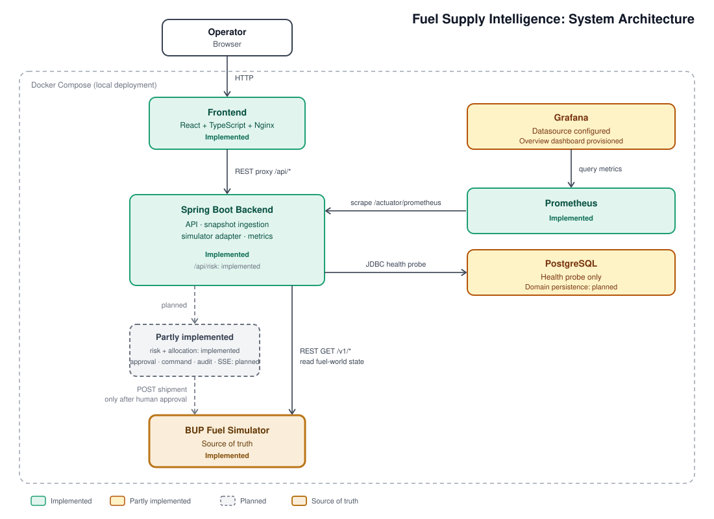
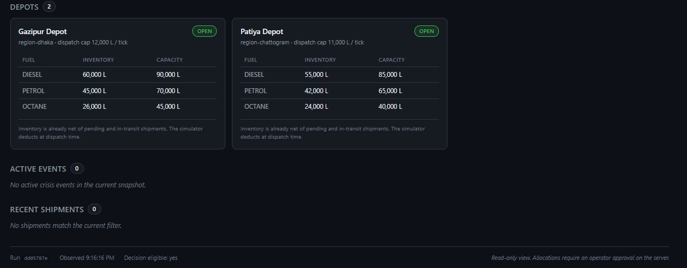
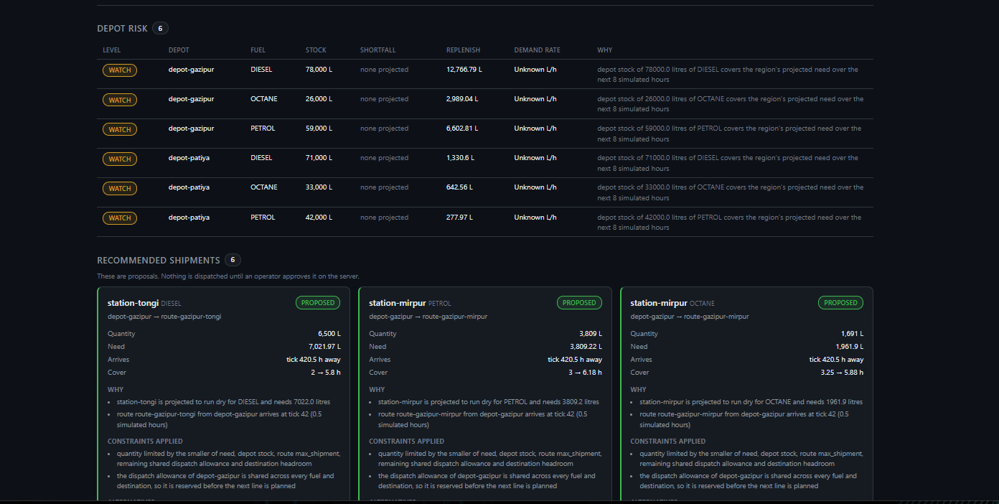
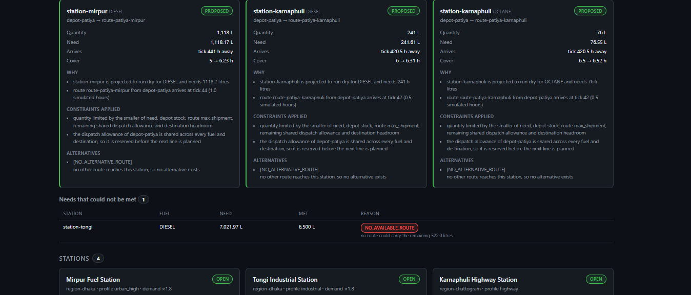
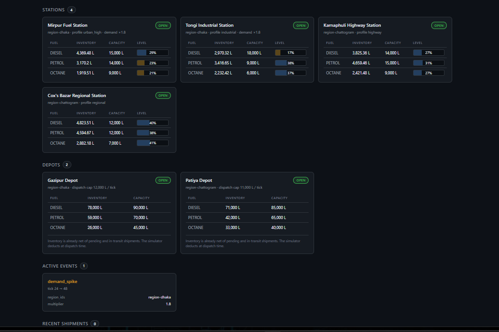
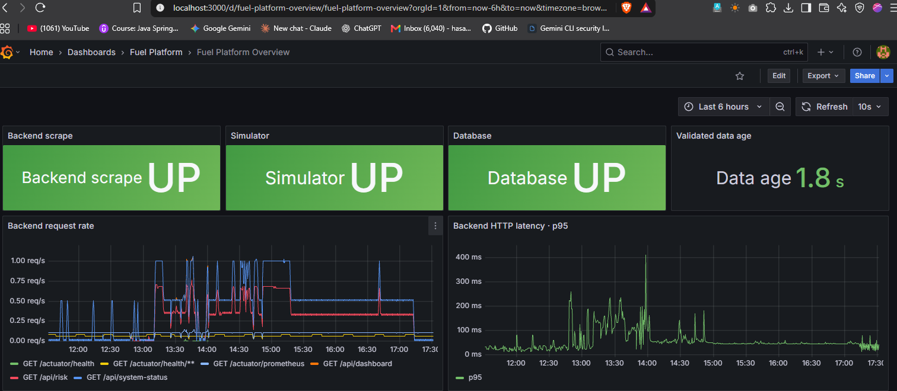

<div align="center">

# Fuel Supply Intelligence

### Explainable risk analysis and supply recommendations for a simulated fuel network

An operator platform built around the official BUP Fuel Supply Simulator.

**Spring Boot · Java 21 · React · TypeScript · PostgreSQL · Docker Compose · Prometheus · Grafana**

</div>

---

## Project status

| Latest milestone | Status date | Release target |
|:--|:--|:--|
| **Phase 01 · Intelligence & Risk** | **Complete · 21 Nov 2026** | 23 Nov 2026 |

The app now turns simulator snapshots into station/depot risk, anomaly flags, forecasts, and constrained shipment proposals. **Proposals do not dispatch fuel:** operator approval, durable commands, and reconciliation are the next phase.

## What the system does

- Reads the official simulator's stations, depots, routes, demand history, events, and shipment ledger.
- Validates and caches a complete snapshot, keeping the last valid view visible with a warning if reads become stale or fail.
- Forecasts demand with EWMA, a naive short-history baseline, and a clearly-labelled profile fallback.
- Projects station stockout timing and depot supply risk, accounting for inbound shipments and simulator tick duration.
- Detects demand anomalies with explainable rules and reports why a flag is known or unexplained.
- Produces constrained shipment proposals with alternatives and unmet-need reasons. It does not write to the simulator.
- Exposes health and metrics to Prometheus; Grafana is provisioned with a Fuel Platform overview dashboard.

> **Source of truth:** the simulator owns fuel inventory, demand, simulation time, events, and shipment status. The application holds validated observations and analysis, not a second fuel world.

## Architecture



The backend reads simulator data through REST. The browser reads the backend through Nginx and never calls the simulator directly. PostgreSQL is running and health-checked, but durable application records are still planned.

## Screenshots

### Day 1 · Live simulator dashboard

<table>
  <tr>
    <td width="50%" align="center"><strong>Station inventory and service health</strong><br><br></td>
    <td width="50%" align="center"><strong>Depot inventory and shipments</strong><br><br></td>
  </tr>
</table>

### Day 2 · Risk, anomaly detection, and recommendations

<table>
  <tr>
    <td width="50%" align="center"><strong>Intelligence summary and demand anomalies</strong><br><br></td>
    <td width="50%" align="center"><strong>Station stockout risk</strong><br><br></td>
  </tr>
  <tr>
    <td width="50%" align="center"><strong>Depot risk and recommended shipments</strong><br><br></td>
    <td width="50%" align="center"><strong>Proposal alternatives and unmet needs</strong><br><br></td>
  </tr>
  <tr>
    <td colspan="2" align="center"><strong>Filtered network inventory and active event</strong><br><br></td>
  </tr>
</table>

The Day 2 images include a controlled `demand_spike` scenario; their values are example run output, not a permanent baseline.

### Grafana · Provisioned operations dashboard

<table>
  <tr>
    <td width="50%" align="center"><strong>Service health, request rate, and p95 latency</strong><br><br></td>
    <td width="50%" align="center"><strong>Error, simulator, data-quality, and intelligence metrics</strong><br><br></td>
  </tr>
</table>

The [Grafana login screenshot](images/grafana-login-screen.png) is retained as a setup reference; the two screenshots above show the provisioned dashboard.

## Phased execution plan

Each phase links to its own Markdown update. Completed work is marked **Done**; future work is clearly labelled.

| Phase | Milestone | Focus areas | Target date |
|:--|:--|:--|:--|
| [Phase 00 · Day 1](docs/daily/Day-01.md) | Bootstrap & simulator contract | Simulator experiments, typed integration, validated dashboard, Compose, CI, metrics | Thu 19 Nov · **Done** |
| [Phase 01 · Day 2](docs/daily/Day-02.md) | Intelligence & risk | Forecasts, station/depot projections, anomaly detection, constrained proposals | Fri 20 Nov · **Done** |
| [Phase 02 · Day 3](docs/daily/Day-03.md) | Persistence & operator decisions | Durable records, human approval, idempotent command processing, shipment tracking | Sat 21 Nov · **Next** |
| [Phase 03 · Day 4](docs/daily/Day-04.md) | Resilience & observability | Fault recovery, guarded writes, SSE, crisis scenarios, operations evidence | Sun 22 Nov · **Planned** |
| [Phase 04 · Day 5](docs/daily/Day-05.md) | Evaluation & release rehearsal | Policy comparison, load evaluation, clean startup, demo rehearsal | Mon 23 Nov · **Planned** |

## Day 2 · What was implemented and measured

- Demand observations are read with a bounded limit, split by fuel, deduplicated, and ordered oldest-first before forecasting.
- Forecast methods are labelled: EWMA for sufficient history, naive for short history, and documented profile fallback for cold starts.
- Station projections include inbound shipment timing; depot projections include supply/replenishment needs.
- Rule-based anomaly detection covers station spikes, regional spikes, clearing behavior, and known-event attribution.
- Allocation planning reserves shared depot dispatch capacity, source stock, route limits, and destination headroom before planning the next proposal.
- Recommendations include alternatives and explicit unmet-need reasons. No allocation POST is issued by this analysis flow.

**Measured results:** 97 of 98 profile hours matched the documented factors; a quiet run produced 0 false anomaly flags; R1 and R2 detected an injected spike in 2 ticks; proposed lines passed shared depot-capacity and route-integrity checks. Thresholds remain proposed and are not claimed as tuned.

## Quick start

Requirements: Docker Desktop with Compose, Git, and Python 3. In PowerShell, create `.env` only if you do not already have one, then start the stack:

```powershell
if (!(Test-Path .env)) { Copy-Item .env.example .env }
docker compose up --build -d
docker compose ps
```

| Service | URL | What to inspect |
|:--|:--|:--|
| Operator console | [localhost:5173](http://localhost:5173) | Inventory, freshness, risk, proposals |
| Dashboard API | [localhost:8080/api/dashboard](http://localhost:8080/api/dashboard) | Validated simulator snapshot |
| Risk API | [localhost:8080/api/risk](http://localhost:8080/api/risk) | Forecast, risk, anomalies, proposals |
| System status | [localhost:8080/api/system-status](http://localhost:8080/api/system-status) | Backend, data, and latency status |
| Prometheus metrics | [localhost:8080/actuator/prometheus](http://localhost:8080/actuator/prometheus) | Raw backend metrics |
| Prometheus UI | [localhost:9090](http://localhost:9090) | Scrape targets and metric queries |
| Grafana | [localhost:3000](http://localhost:3000) | Dashboards → Fuel Platform → Fuel Platform Overview |
| Simulator | [localhost:8000/v1/instance](http://localhost:8000/v1/instance) | Simulator mode and tick clock |

Grafana local credentials are configured in `.env.example`; use the values in your `.env` if overridden.

## How data moves

1. Docker Compose starts the simulator, PostgreSQL, backend, frontend, Prometheus, and Grafana.
2. The backend reads simulator REST resources, validates them, then publishes one complete snapshot.
3. The React console polls backend dashboard, status, and risk APIs through Nginx.
4. Prometheus scrapes `/actuator/prometheus` every 10 seconds; Grafana queries Prometheus.
5. A proposal is analysis output only. The planned approval/command flow will be responsible for any future simulator write.

### Two clocks

| Clock | Meaning |
|:--|:--|
| Simulation tick | Fuel-world time; default 15 simulated minutes per tick. Drives demand, transit, and supply events. |
| Wall clock | Real time. Drives request timeouts, polling, and snapshot age. |

A paused simulator may stay on one tick while its API remains healthy. Data freshness is measured from the last successful validated read using wall-clock time.

## Verification and evidence

The repository's Day 2 update reports **83 backend tests passed**. The frontend has **22 unit tests**. Day 1's saved live-stack report records **34 checks**. Day 2 also records independent simulator measurements for anomaly detection and allocation constraints.

```powershell
# Backend tests
Set-Location backend
.\mvnw.cmd verify
Set-Location ..

# Frontend unit tests and production build
Set-Location frontend
npm ci
npm run test
npm run build
Set-Location ..

# Live-stack / simulator checks (use a disposable simulator run)
python scripts/verify_day1.py
python scripts/verify_filters.py
python scripts/verify_anomaly_detection.py
python scripts/verify_dispatch_limit.py
```

Evidence: [`docs/evidence/day-01/`](docs/evidence/day-01/) and [`docs/evidence/day-02/`](docs/evidence/day-02/).

## Repository map

```text
backend/src/main/java/com/fuelplatform/
  simulator/       Typed simulator client, DTOs, errors, metrics
  ingestion/       Refresh, validation, snapshot publication
  domain/          WorldSnapshot, mode, quality
  risk/            Demand history, forecasts, station/depot risk, anomaly rules
  allocation/      Feasible proposals, constraints, alternatives
  web/             Dashboard, status, and risk APIs
  observability/    Health registry and application metrics
frontend/src/       React console, filters, and risk panels
infra/              Compose monitoring configuration for Prometheus/Grafana
images/             Architecture, dashboard, and Grafana screenshots
docs/daily/          Day-by-day implementation notes
docs/evidence/       Recorded verification and measurement outputs
docs/adr/            Architecture Decision Records
scripts/             Simulator control and verification helpers
```

## Documentation

| Document | Description |
|:--|:--|
| [Day 1 update](docs/day-01-update.md) | Simulator contract findings and first working vertical slice |
| [Day 2 update](docs/daily/Day-02.md) | Forecast, risk, anomaly, and allocation implementation with evidence |
| [Current state](docs/current-state.md) | Implemented modules and immediate next steps |
| [System architecture](docs/system-architecture.md) | Current services and implemented/planned boundaries |
| [Measured simulator contract](docs/contract-notes.md) | API behavior established by experiments |
| [Acceptance criteria and invariants](docs/acceptance-and-invariants.md) | Safety rules and acceptance stories |
| [Architecture decisions](docs/adr/) | Design decisions and trade-offs |
| [Issue board](docs/issue-board.md) | Work breakdown and cut order |
| [Full implementation guide](Fuel%20Management%20System%20md%20file/Fuel_Management_Implementation_Guide_v2.md) | Five-day build guide |

## Next phase

Day 3 adds durable decision records, operator approval, a server-side freshness guard, and idempotent command processing. Until that path is implemented, the dashboard's recommendations remain proposals and do not dispatch fuel.

## Attribution

This project uses the official `asifmahmoud414/bup-fuel-supply-simulator:1.0.0` image without modifying it. The simulator remains authoritative for operational fuel-world state.
