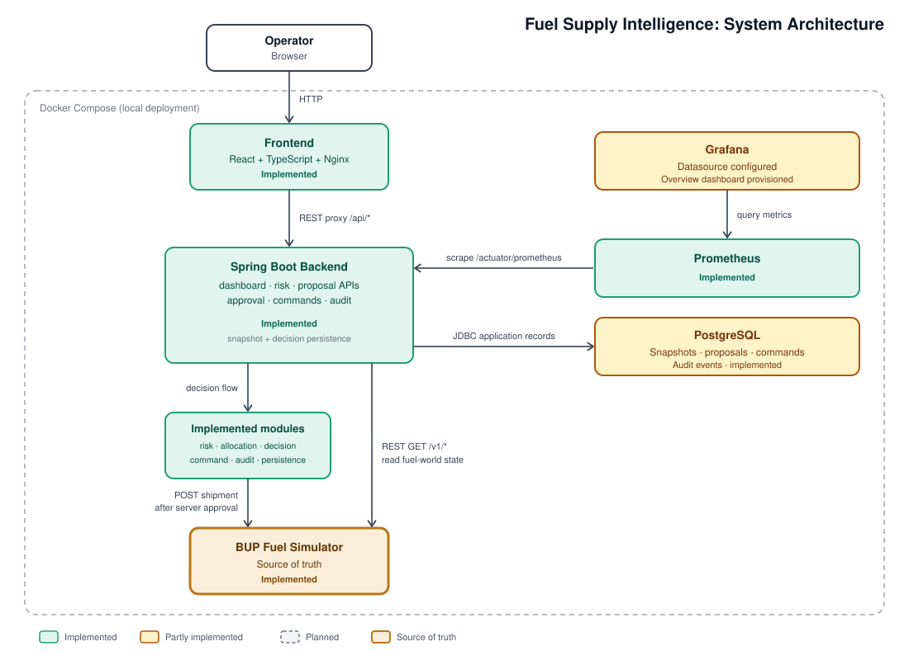
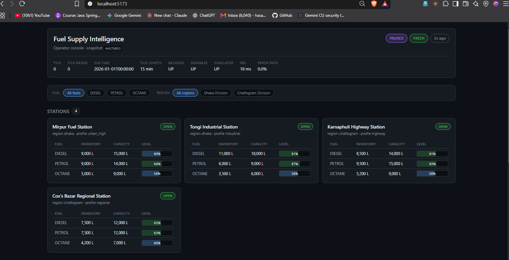
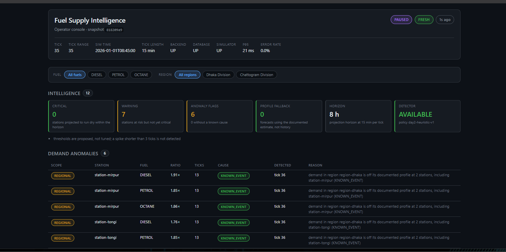
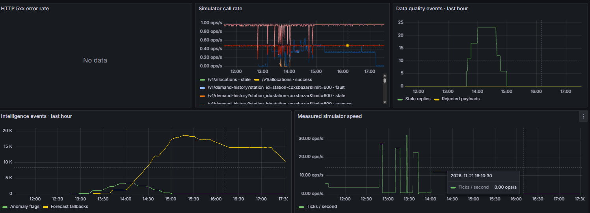

<div align="center">

# ⛽ Fuel Supply Intelligence

### Explainable risk analysis and supply recommendations for a simulated fuel network

An operator platform built around the **official BUP Fuel Supply Simulator**.

<p>
  
  
  
  
  
</p>

<p>
  <a href="#project-status">Project status</a> ·
  <a href="#phased-execution-plan">Execution plan</a> ·
  <a href="#architecture">Architecture</a> ·
  <a href="#run-locally">Run locally</a>
</p>

</div>

---

## Project status

| Latest milestone | Status date | Release target |
|---|---|---|
| **Phase 01 · Intelligence & Risk** | **Complete · 21 Nov 2026** | 23 Nov 2026 |

The application turns simulator snapshots into station and depot risk, anomaly flags, forecasts, and constraint-checked shipment proposals. **Proposals do not dispatch fuel**; operator approval, durable commands, and reconciliation are planned work.

## Phased execution plan

Each phase links to its detailed Markdown update. This table tracks the project roadmap; implementation notes and evidence remain in the linked documents.

| Phase | Milestone | Focus areas | Target date / status |
|---|---|---|---|
| [Phase 00 · Day 1](docs/daily/Day-01.md) | Bootstrap & simulator contract | Simulator experiments, typed integration, validated dashboard, Compose, CI, metrics | Thu 19 Nov · **Done** |
| [Phase 01 · Day 2](docs/daily/Day-02.md) | Intelligence & risk | Forecasts, station/depot projections, anomaly detection, constrained proposals | Fri 20 Nov · **Done** |
| [Phase 02 · Day 3](docs/daily/Day-03.md) | Persistence & operator decisions | Durable records, human approval, idempotent command processing, shipment tracking | Sat 21 Nov · **Next** |
| [Phase 03 · Day 4](docs/daily/Day-04.md) | Resilience & observability | Fault recovery, guarded writes, SSE, crisis scenarios, operations evidence | Sun 22 Nov · **Planned** |
| [Phase 04 · Day 5](docs/daily/Day-05.md) | Evaluation & release rehearsal | Policy comparison, load evaluation, clean startup, documentation, demo rehearsal | Mon 23 Nov · **Planned** |

---

## Overview

The platform is a read-only operator console over a simulated fuel network. The simulator owns the live network state; this application reads and validates that state, then adds monitoring and decision-support views.

| Capability | Current state |
|---|---|
| Simulator integration and validated network snapshots | Implemented |
| Station/depot inventory, health, freshness, and filters | Implemented |
| Demand forecasts, stockout risk, and rule-based anomaly flags | Implemented |
| Constraint-checked shipment proposals with alternatives and unmet-need reasons | Implemented; proposals are advisory |
| Prometheus metrics and provisioned Grafana overview | Implemented |
| Operator approval, shipment command processing, and durable decision/audit records | Planned |

**Source of truth:** station inventory, depot inventory, demand, and shipment state come from the simulator. The platform does not treat its proposal as a dispatched shipment. PostgreSQL is available in the local Compose stack and participates in backend health checks; durable application-domain persistence is not currently implemented.

## Architecture



The browser talks only to the Spring Boot API. The backend communicates with the simulator over its REST API. Prometheus scrapes backend metrics, and Grafana reads those metrics from Prometheus. All services run locally through Docker Compose.

## Screenshots

| Operator console | Risk and forecasting |
|---|---|
| **Station inventory and service health**<br> | **Risk summary and anomaly flags**<br> |
| **Depot inventory and shipment view**<br> | **Station stockout risk**<br> |
| **Network inventory and active-event view**<br> | **Depot risk and recommendations**<br> |
| **Proposal alternatives and unmet needs**<br> | **Grafana service health**<br> |
| **Grafana metrics overview**<br> | **Grafana sign-in screen**<br> |

The event screenshot shows one simulator scenario; values and event state can change as the simulator runs. Grafana credentials are configurable in `.env` (see `.env.example`).

## Project structure

```text
Fuel-Management-System/
├── backend/
│   ├── src/main/java/com/fuelplatform/
│   │   ├── allocation/       # Constraint-aware shipment proposal planning
│   │   ├── config/           # Simulator, forecast, risk, clock, and health settings
│   │   ├── domain/           # Snapshot and simulation domain types
│   │   ├── ingestion/        # Snapshot refresh, validation, and publication
│   │   ├── observability/    # Health state and operational metrics
│   │   ├── risk/             # Demand forecast, anomaly, and supply-risk logic
│   │   ├── simulator/        # Simulator HTTP client, DTOs, and metrics
│   │   └── web/              # Dashboard, risk, and system-status REST endpoints
│   └── src/test/             # Backend unit and integration tests
├── frontend/
│   └── src/
│       ├── App.tsx           # Operator console composition
│       ├── RiskPanel.tsx     # Risk and proposal views
│       ├── filters.ts        # Fuel and region filtering
│       ├── useDashboard.ts   # Dashboard API/state hook
│       └── useRisk.ts        # Risk API/state hook
├── infra/
│   ├── grafana/provisioning/ # Prometheus data source and dashboard setup
│   └── prometheus/           # Prometheus scrape configuration
├── images/                   # Architecture and README screenshots
├── scripts/                  # Local simulator and behavior verification helpers
├── docs/
│   ├── adr/                  # Architecture decision records
│   ├── evidence/             # Captured measurements and verification evidence
│   ├── issues/               # Feature and implementation specifications
│   ├── system-architecture.md
│   ├── architecture-diagram.md
│   ├── acceptance-and-invariants.md
│   └── current-state.md
├── compose.yaml              # Local multi-service deployment
└── .env.example              # Example local configuration
```

## Run locally

Requirements: Docker Desktop with Compose enabled. From the repository root:

```powershell
Copy-Item .env.example .env   # only needed if you do not already have a local .env
docker compose up --build -d
docker compose ps
```

Open the services:

| Service | Local URL |
|---|---|
| Fuel Supply Intelligence UI | [http://localhost:5173](http://localhost:5173) |
| Backend API | [http://localhost:8080](http://localhost:8080) |
| Simulator API | [http://localhost:8000](http://localhost:8000) |
| Prometheus | [http://localhost:9090](http://localhost:9090) |
| Grafana | [http://localhost:3000](http://localhost:3000) |

Stop the services with `docker compose down`. Add `-v` only when you intend to remove named volumes as well.

## How the data flows

1. The official simulator maintains the simulated fuel network and its state.
2. The backend periodically reads simulator data, validates snapshots, and exposes the operator API. The main application routes include `/api/dashboard`, `/api/risk`, and `/api/system-status`.
3. The React frontend reads the backend API and renders inventory, freshness, risk, anomalies, and advisory proposals. It does not call the simulator directly.
4. Prometheus collects backend metrics from `/actuator/prometheus`; Grafana queries Prometheus for its provisioned overview.

Shipment proposals are decision support only. This application does not currently approve or dispatch them. PostgreSQL is started by Compose, but the current application does not persist domain records there.

## Simulator time and real time

These are separate clocks:

- **Simulator tick:** one tick advances the simulated fuel world by 15 simulated minutes, according to the Compose configuration. A tick can happen faster or slower than one real second; configured simulator speed is a target, not a guaranteed tick rate.
- **Wall clock:** real elapsed time on the computer running the application. The dashboard uses this to describe how recently the backend last completed a successful read.

When the simulator is paused, its tick and simulated time can stay still while the backend remains healthy and continues to serve its last valid snapshot. A successful HTTP response alone does not guarantee fresh simulator data; the backend also checks simulator freshness metadata.

## Build and verification

Run these from the repository root when working on the corresponding component:

```powershell
Set-Location backend
.\mvnw.cmd verify
```

```powershell
Set-Location frontend
npm ci
npm run test
npm run build
```

The scripts in `scripts/` can exercise simulator behavior and allocation invariants. Some interact with simulator state, so run them against a disposable local simulator instance. CI configuration is in `.github/workflows/`.

## Documentation

- [System architecture](docs/system-architecture.md) — component diagram, communication paths, and ownership boundaries
- [Architecture notes](docs/architecture-diagram.md) — design context and simulator behavior
- [Acceptance criteria and invariants](docs/acceptance-and-invariants.md) — important operational rules
- [Contract notes](docs/contract-notes.md) — integration details and API observations
- [Current state](docs/current-state.md) — implementation status and verification notes
- [Architecture decisions](docs/adr/) — recorded design decisions
- [Issue board](docs/issue-board.md) — tracked work and specifications

## Simulator attribution

This project integrates with the official BUP Fuel Supply Simulator image configured in `compose.yaml`. Its simulated network remains the authority for fuel inventory, demand, and shipment state.
