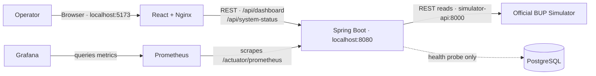
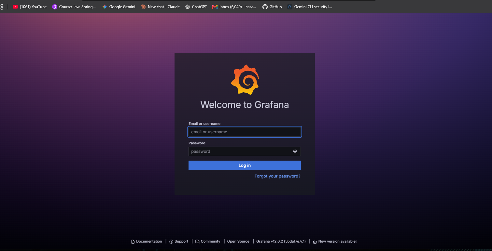

<div align="center">

# Fuel Supply Intelligence

### A decision-support platform for a simulated fuel supply network

Monitor stations and depots, understand data quality, and build toward safer, explainable supply decisions.

**Spring Boot · Java 21 · React · TypeScript · PostgreSQL · Docker Compose · Prometheus · Grafana**

</div>

---

## Project status

| Current milestone | Release target | Current focus |
|:--|:--|:--|
| **Phase 00 complete — Day 1 foundation** | **23 Nov 2026** | Simulator integration, validated read-only dashboard, and observability |

> **What works now:** the application reads and validates the official simulator's world and displays it in an operator console. Forecasting, risk recommendations, operator approval, and dispatch workflow are planned phases; they are not presented as implemented features.

## At a glance

The official BUP Fuel Supply Simulator owns the simulated world: station and depot inventory, demand, simulation time, events, and shipment state. This project adds a Spring Boot integration layer, a React operator console, and monitoring around that world.



The diagram shows PostgreSQL as a health-check dependency only. The Day 1 backend does not persist application snapshots, recommendations, or audit records there. Grafana has a Prometheus datasource configured; a project-specific Grafana dashboard is planned.

### Visual tour


### Operator console screenshots

<table>
  <tr>
    <td width="50%" align="center">
      <strong>Station inventory and system health</strong><br><br>
      
    </td>
    <td width="50%" align="center">
      <strong>Depot inventory and shipment section</strong><br><br>
      
    </td>
  </tr>
  <tr>
    <td width="50%" align="center">
      <strong>Grafana access</strong><br><br>
      
    </td>
    <td width="50%" align="center">
      <em>Project-specific Grafana operations dashboard is planned.</em>
    </td>
  </tr>
</table>

## Five-day phased execution plan

The table follows the phase / milestone / focus / target-date layout. Each day links to its own Markdown page with the planned work, evidence, and current status.

| Phase | Milestone | Focus areas | Target date |
|:--|:--|:--|:--|
| [Phase 00 · Day 1](docs/daily/Day-01.md) | Bootstrap & simulator contract | Repository foundation, measured simulator behavior, typed integration, validated read-only dashboard, Prometheus, Compose, CI | Thu 19 Nov — **Done** |
| [Phase 01 · Day 2](docs/daily/Day-02.md) | Intelligence & risk | Demand history, forecasting, station/depot projection, anomaly detection, feasible recommendations and alternatives | Fri 20 Nov — **Planned** |
| [Phase 02 · Day 3](docs/daily/Day-03.md) | Persistence & operator decisions | Database migrations, recommendation review, mode-aware approval, idempotent command processing, shipment tracking | Sat 21 Nov — **Planned** |
| [Phase 03 · Day 4](docs/daily/Day-04.md) | Resilience & observability | Fault recovery, guarded writes, SSE with REST fallback, crisis scenarios, Grafana panels, deployment evidence | Sun 22 Nov — **Planned** |
| [Phase 04 · Day 5](docs/daily/Day-05.md) | Evaluation & release rehearsal | Baseline comparison, load testing, clean startup, documentation freeze, demo rehearsal | Mon 23 Nov — **Planned** |

> Dates follow the project guide. The repository's progress notes are dated 20 Nov 2026; update the phase statuses as work progresses.

## Quick start

Requirements: Docker Desktop with Compose, Git, and Python 3 for the verification scripts. Create `.env` from the example only if you do not already have a local environment file, then start the stack:

```powershell
if (!(Test-Path .env)) { Copy-Item .env.example .env }
docker compose up --build -d
docker compose ps
```

Open the local services:

| Service | URL | Purpose |
|:--|:--|:--|
| Operator console | [http://localhost:5173](http://localhost:5173) | React dashboard |
| Dashboard API | [http://localhost:8080/api/dashboard](http://localhost:8080/api/dashboard) | Latest validated simulator snapshot |
| System status | [http://localhost:8080/api/system-status](http://localhost:8080/api/system-status) | Component health, data freshness, p95, and error rate |
| Prometheus metrics | [http://localhost:8080/actuator/prometheus](http://localhost:8080/actuator/prometheus) | Backend metrics endpoint |
| Prometheus UI | [http://localhost:9090](http://localhost:9090) | Scraped metric queries |
| Grafana | [http://localhost:3000](http://localhost:3000) | Metrics exploration; local defaults are in `.env.example` |
| Simulator API | [http://localhost:8000/v1/instance](http://localhost:8000/v1/instance) | Simulator instance and clock state |

The Compose file binds services to localhost. Check `.env.example` for ports and local credentials; change default development credentials before sharing a machine or deployment.

## How the system works

1. **Simulator owns operational truth.** The backend reads the official simulator through its REST API; the browser never connects to it directly.
2. **Backend refreshes and validates.** A scheduled refresh reads simulator resources, checks required fields and publishes a complete snapshot atomically.
3. **The UI reads the backend view.** React polls `/api/dashboard` and `/api/system-status` through the frontend Nginx proxy.
4. **Failures stay visible.** If a read fails or is marked stale, the last valid snapshot can remain on screen with its age and warning. Ineligible data is not treated as decision-ready.
5. **Prometheus collects metrics.** It scrapes `/actuator/prometheus` every 10 seconds. Grafana is configured to use Prometheus as its datasource.

### Two clocks, two meanings

| Clock | What it measures | Used for |
|:--|:--|:--|
| Simulation tick | Fuel-world time; default is 15 simulated minutes per tick | Demand, inventory changes, transit, and supply events |
| Wall clock | Real elapsed seconds | Refresh age, timeouts, and service latency |

A paused simulator can stay on the same tick while remaining reachable. Freshness is therefore based on the wall-clock age of a successful validated read, not merely on whether the tick changed.

## Project structure

```text
backend/                 Spring Boot API and simulator integration
  src/main/java/com/fuelplatform/
    simulator/           Typed simulator adapter, DTOs, error parsing, metrics
    ingestion/           Refresh scheduling, validation, snapshot publication
    domain/              WorldSnapshot, simulation mode, data quality
    web/                 Dashboard and system-status endpoints
    observability/       Health registry and custom metrics
frontend/                React + TypeScript operator console
infra/                    Prometheus and Grafana provisioning
scripts/                  Simulator controls and verification scripts
docs/
  daily/                  Per-day phase plans and progress links
  adr/                    Architecture Decision Records
  evidence/day-01/        Simulator experiments and verification evidence
```

## Verification

Run the checks that match your environment:

```powershell
# Backend unit tests
Set-Location backend
.\mvnw.cmd verify
Set-Location ..

# Frontend tests and production build
Set-Location frontend
npm ci
npm run test
npm run build
Set-Location ..

# End-to-end checks against the running Compose stack
python scripts/verify_day1.py
python scripts/verify_filters.py
```

The saved Day 1 reports are in [`docs/evidence/day-01/`](docs/evidence/day-01/). They record checks performed against the running stack; rerun them after changing the implementation.

## Simulator controls

The helper script is for local simulator experiments and demonstrations:

```powershell
python scripts/sim_control.py instance
python scripts/sim_control.py step 5
python scripts/sim_control.py run
python scripts/sim_control.py pause
python scripts/sim_control.py inject-fault stale_data 15
python scripts/sim_control.py inject-fault unavailable 30
python scripts/sim_control.py clear-faults
```

Use a disposable simulator run for experiments that change world state. Record the seed, tick, and injected event/fault when saving evidence.

## Documentation & evidence

| Resource | Description |
|:--|:--|
| [System architecture](docs/system-architecture.md) | Current service topology and implemented versus planned components |
| [Architecture notes](docs/architecture-diagram.md) | Truth ownership, the two clocks, and modular-monolith decisions |
| [Current state](docs/current-state.md) | Implemented modules, known gaps, and next tasks |
| [Day 1 update](docs/day-01-update.md) | Detailed progress report and measured simulator findings |
| [Day 1 talking points](docs/day-01-talking-points.md) | Concise update narrative with evidence references |
| [Contract notes](docs/contract-notes.md) | Measured simulator API behavior |
| [Acceptance criteria & invariants](docs/acceptance-and-invariants.md) | Product acceptance stories and engineering rules |
| [Architecture decisions](docs/adr/) | ADRs explaining key design choices |
| [Issue board](docs/issue-board.md) | Planned implementation issues and cut order |
| [Agent activity log](docs/agent-activity-log.md) | Work and decisions recorded by session |
| [Implementation guide](Fuel%20Management%20System%20md%20file/Fuel_Management_Implementation_Guide_v2.md) | Full five-day engineering guide |

## Current scope and next steps

**Implemented in the Day 1 foundation:** simulator reads, typed adapter, snapshot validation, cached degraded view, dashboard and status APIs, read-only React console, metrics endpoint, Compose deployment, and CI workflow.

**Planned next:** forecasting and risk, anomaly detection, constrained recommendations, persistence, operator approval, shipment command lifecycle, SSE refresh, Grafana dashboards, load evaluation, and final demo rehearsal. See the [phase plan](#five-day-phased-execution-plan) for per-day details.

## License & simulator attribution

The project integrates with the official `asifmahmoud414/bup-fuel-supply-simulator:1.0.0` image without modifying it. The simulator is a dependency; its operational state remains authoritative.
