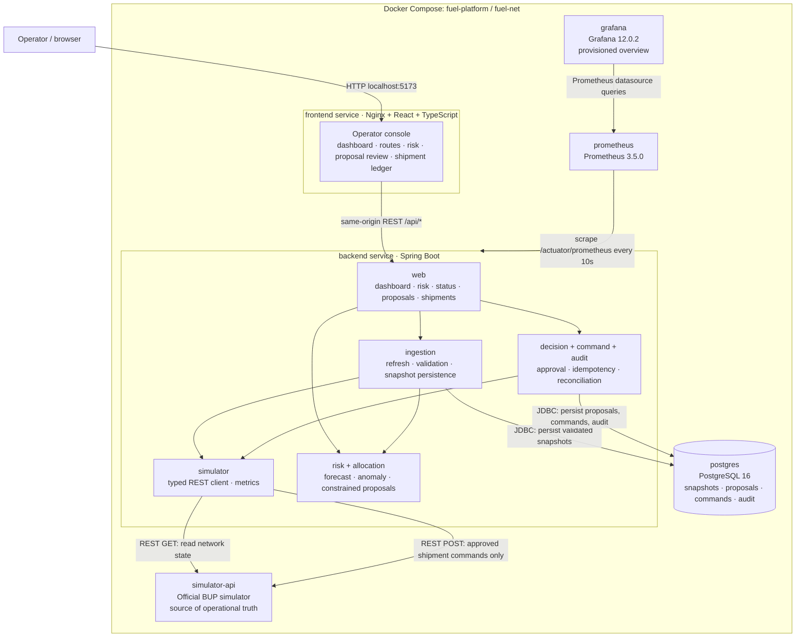

# System Architecture

**Status:** checked against the implementation on 22 November 2026.

## Architecture diagram

## Main data flow

1. Docker Compose starts the official simulator, PostgreSQL, Spring Boot backend, React/Nginx frontend, Prometheus, and Grafana.
2. The backend reads simulator instance, regions, depots, stations, routes, demand history, supply arrivals, events, and shipment state. It validates the response and publishes a consistent snapshot.
3. Validated snapshots are persisted for audit and review context. The simulator remains the authority for current inventory, demand, events, and shipment state.
4. The risk and allocation modules calculate forecasts, anomalies, station/depot risks, and constrained shipment proposals. The frontend displays the full route list from the snapshot.
5. An operator reviews a proposal. The backend revalidates it, persists the decision and each exact idempotent command before sending an approved request to the simulator. Reconciliation links uncertain outcomes back to simulator shipment records.
6. Prometheus scrapes backend metrics. Grafana reads those metrics through its provisioned Prometheus datasource and dashboard.

The browser communicates only with the backend through the frontend's same-origin Nginx proxy. It never calls the simulator directly. Shipment creation can reach the simulator only through the backend approval and command path.

## Data ownership and persistence

The simulator is the source of truth for operational fuel inventory, demand, simulation time, events, and shipment status. PostgreSQL stores the platform's validated snapshots, proposals, approval decisions, command request bodies and idempotency keys, reconciliation results, and audit events. Those records explain the application actions; they do not replace simulator state.

## Simulator ticks and wall-clock time

- **Simulator time:** Compose defaults to 15 simulated minutes per tick. Ticks advance fuel consumption, route transit, and simulator events.
- **Wall-clock time:** real time on the host. The backend uses it for request timing, refresh age, freshness limits, and review expiry.

A paused simulator can keep the same tick while its API and the application remain healthy. Freshness is measured from the last successful validated read using wall-clock age, not by expecting the tick to advance.

## Implemented and planned work

Implemented modules include `web`, `ingestion`, `simulator`, `domain`, `risk`, `allocation`, `decision`, `command`, `audit`, and `observability`. The current decision flow includes proposal review, server-side approval checks, persistent idempotent commands, shipment reconciliation, and an audit trail. The frontend includes an explicit route inventory, the decision panel, and shipment ledger.

Resilience improvements and SSE-based event refresh remain planned work. Their absence does not prevent the current REST polling and approval flow.

## Repository references

- Compose services and ports: [`compose.yaml`](../compose.yaml)
- Backend packages: [`backend/src/main/java/com/fuelplatform/`](../backend/src/main/java/com/fuelplatform/)
- Frontend console: [`frontend/src/App.tsx`](../frontend/src/App.tsx)
- Decision UI: [`frontend/src/DecisionPanel.tsx`](../frontend/src/DecisionPanel.tsx)
- Prometheus scrape config: [`infra/prometheus/prometheus.yml`](../infra/prometheus/prometheus.yml)
- Grafana provisioning: [`infra/grafana/provisioning/`](../infra/grafana/provisioning/)
- Day 3 implementation and evidence: [`docs/daily/Day-03.md`](daily/Day-03.md)
